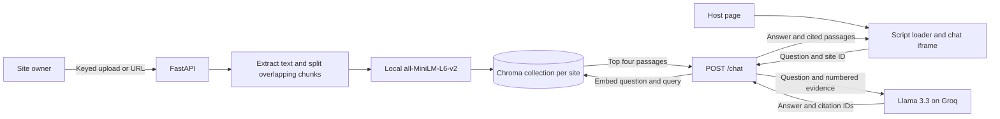

# DocBot

DocBot adds a documentation chat bubble to a website with one script tag. FastAPI indexes PDF, UTF-8 text, Markdown and single web pages in a local Chroma database. For each question it sends up to four passages from that site to Groq’s Llama 3.3 70B. The chat window displays the passages the model cites.

The included Orbit documentation describes a fictional product. The sample retrieval eval found supporting evidence for 17/17 questions. Live Groq answer quality, mobile rendering and hosted deployment still need verification. See [STATUS.md](STATUS.md) for the review and test record.

**Demo GIF placeholder** · A recording of the embed opening, answering and displaying a source belongs here.

## Local quick start

With the supplied virtualenv and cached model, start from the repository root on Linux. Set a Groq key in the backend’s existing `.env`. Start-up time on a clean machine also depends on downloading PyTorch and the model.

```bash
source .venv/bin/activate
export HF_HUB_OFFLINE=1   # only when MiniLM is already cached
python ingest.py --site orbit
python -m uvicorn app:app --port 8000
```

Open <http://127.0.0.1:8000/static/demo.html>, open **Ask support**, and ask “How long does a workspace invitation last?” The direct chat page is at `/`. Ingestion and retrieval evaluation work with an empty Groq key.

**Fresh install** (Linux, Python 3.11 recommended). On Debian/Ubuntu install `poppler-utils`, `util-linux` and `curl` for PDF and URL imports. Then run the following before the quick start. Leave `HF_HUB_OFFLINE` unset on the first model load.

```bash
python3 -m venv .venv
source .venv/bin/activate
python -m pip install --index-url https://download.pytorch.org/whl/cpu torch==2.6.0
python -m pip install -r requirements.txt
cp -n .env.example .env
```

## Backend settings

| Variable | Purpose |
| --- | --- |
| `GROQ_API_KEY` | Required for generated answers. Only the backend reads it. Each chat sends its question and retrieved text to Groq. |
| `SITE_ADMIN_KEYS` | JSON object mapping site IDs to independent secrets. Default `{}` disables remote document management. |
| `ALLOWED_ORIGINS` | Comma-separated exact browser origins for CORS and framing the chat, e.g. `https://shop.example,https://demo.example`. Defaults to localhost and 127.0.0.1 on port 8000. |
| `RATE_LIMIT_PER_MINUTE` | Combined chat and document requests per client IP per process. Default 30. Restart clears counters. Clients sharing a proxy may share a bucket. Only trust forwarded IPs from your actual reverse proxy. |
| `CHROMA_PATH` | Persistent index directory. Defaults to `./chroma_db` beside the code. |
| `PORT` | Container listener port, default 8000. For the local CLI use `--port`. |

Site IDs use 1–48 lowercase ASCII letters, digits and hyphens, starting with a letter or digit. They appear in page source. **Only index material visitors may read.** Anyone with a site ID can query that site's public chat. Admin keys authorize uploads, listing and deletion. Generate a secret with `python -c 'import secrets; print(secrets.token_urlsafe(32))'`, set e.g. `SITE_ADMIN_KEYS='{"orbit":"YOUR_GENERATED_SECRET"}'` in the backend environment, then restart. Keep each site's key distinct.

## Embed

Add the host page’s exact origin to `ALLOWED_ORIGINS`. Replace the example backend hostname with your deployed HTTPS backend and choose the same site ID used for ingestion.

```html
<script defer src="https://support.example/static/widget.js" data-site="orbit"></script>
```

The plain-JS loader creates a floating button and opens the existing chat page in a responsive iframe. For hosts with a Content Security Policy, permit the backend in `script-src` and `frame-src`.

## Document and chat API

Set `DOCBOT_ADMIN_KEY` in your terminal to the configured secret for `orbit`. The HTTP endpoints also appear at `/docs`. File uploads use the raw request body and a URL-encoded filename query parameter.

```bash
api=http://127.0.0.1:8000
curl -f "$api/sites/orbit/documents?filename=policy.md" \
  -H "X-Admin-Key: $DOCBOT_ADMIN_KEY" -H 'Content-Type: application/octet-stream' \
  --data-binary @docs/pricing-and-billing.md
curl -f "$api/sites/orbit/urls" -H "X-Admin-Key: $DOCBOT_ADMIN_KEY" \
  -H 'Content-Type: application/json' -d '{"url":"https://example.com/"}'
curl -f "$api/sites/orbit/documents" -H "X-Admin-Key: $DOCBOT_ADMIN_KEY"
curl -f -X DELETE "$api/sites/orbit/documents/$document_id" -H "X-Admin-Key: $DOCBOT_ADMIN_KEY"
curl -f "$api/chat" -H 'Content-Type: application/json' \
  -d '{"site_id":"orbit","question":"How long does a workspace invitation last?"}'
```

Use the `document_id` from upload or list for deletion. Importing the same name and content again reuses its ID. Changed content creates a revision with a new ID. Delete obsolete revisions explicitly. Run the sample CLI before starting the worker. Existing prototype installations can repopulate the new `orbit` collection with `python ingest.py`. The legacy `/ask` route still accepts a question for that site.

- Upload limit is 2 MB, and extracted text is limited to 500,000 characters. PDFs need a text layer. URL import reads a single UTF-8 HTML or plain-text page at its final public IPv4 URL. It skips scripts and styles. Redirects and JavaScript rendering are unsupported.
- Successful chat returns `answer` and `sources`. Each cited passage includes `document_id`, `filename` (or URL), zero-based `chunk_index`, `text` and cosine similarity `score`. Scores describe similarity. A valid citation can still accompany an unsupported claim.
- The prompt asks for abstention when evidence is insufficient. Missing or out-of-range citation IDs on an otherwise parsed answer trigger abstention with empty sources. Answers arrive together with their sources. Token streaming is deferred.
- A blank question returns 400, an invalid admin key 403, an empty site or unknown deletion target 404, an oversized upload 413, invalid input 422 and rate limiting 429 with `Retry-After`. Missing Groq configuration returns 503 and an upstream failure or malformed provider payload returns 502.

## Architecture



## Verify

```bash
python -m unittest discover -s tests -v
python eval.py
python eval.py --answers
```

Tests use a temporary real Chroma index and MiniLM, with controlled provider responses. The eval builds a fresh temporary index from the five sample docs. Hit@4 requires both the expected file and the expected fact in the same retrieved chunk. `--answers` makes 19 Groq calls and additionally counts answers containing the expected literal fact with a matching cited chunk, plus abstentions on two unsupported questions. This lexical check can miss paraphrases and overlook additional unsupported claims. Read the printed answers alongside their evidence before judging answer quality.

## Deploy

**Railway backend.** Deploy this repository using the root Dockerfile, set the backend variables, attach a volume at `/data`, and keep one worker and one replica. The image caches MiniLM at build time and uses `/data/chroma` at runtime. Use `/health` as a process health check. Upload documents after deployment. For a local container, use `docker build -t docbot .` and `docker run --rm --env-file .env -p 8000:8000 -v docbot-data:/data docbot` (use a Docker-compatible env file, without shell quoting around JSON). [Railway Dockerfiles](https://docs.railway.com/builds/dockerfiles) · [Persistent volumes](https://docs.railway.com/volumes/reference)

**Vercel demo.** Import the repository with the root as the project directory. Set the build variable `DOCBOT_BACKEND_URL` to the HTTPS Railway origin. The build uses Node to write one static page in `dist/`. Add the Vercel demo origin to the backend’s `ALLOWED_ORIGINS`, restart the backend, and populate site `orbit`. The demo only receives the public backend URL and site ID. [Vercel configuration](https://vercel.com/docs/project-configuration/vercel-json)

Local storage and embeddings run on your machine. Hosted resource charges and Groq usage depend on the accounts and quotas you choose. Neither deployment was provisioned in this review.
